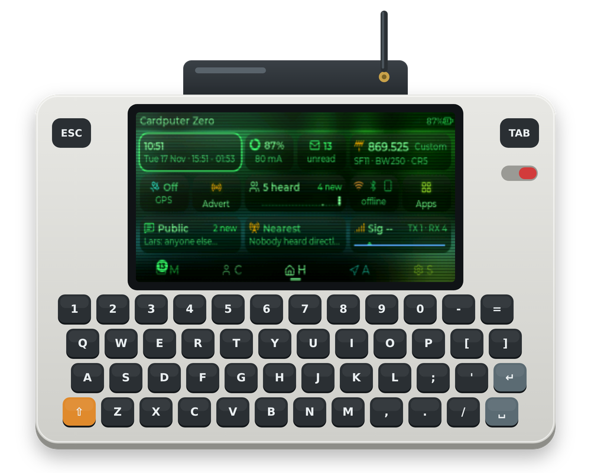
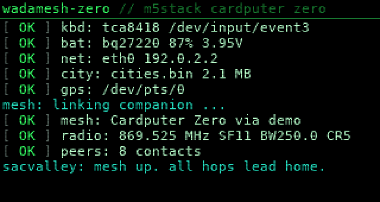
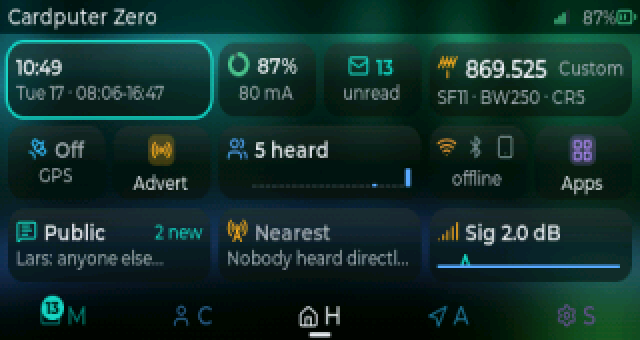
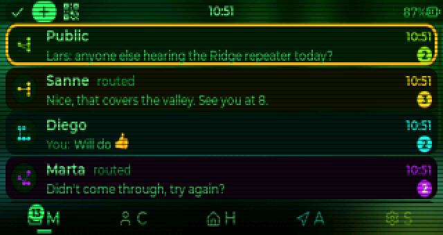
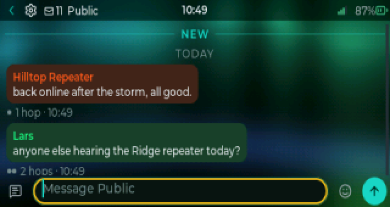
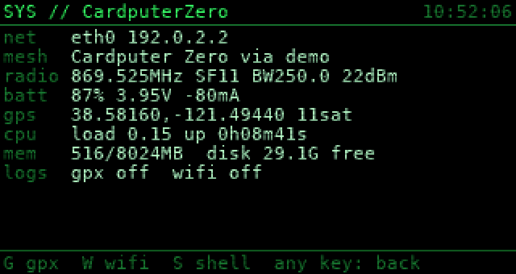
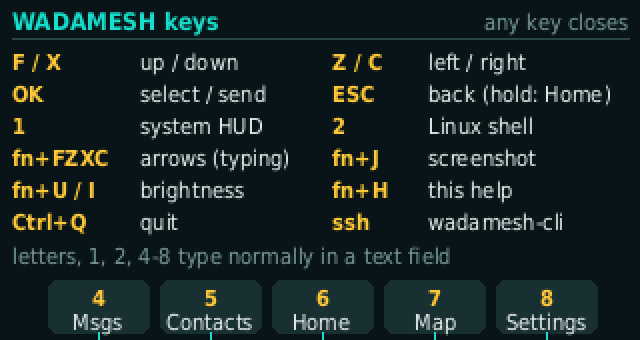
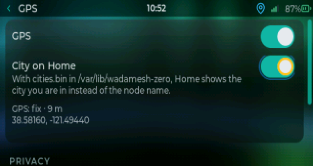
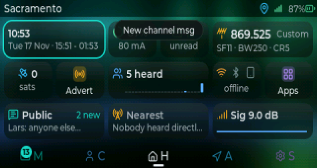
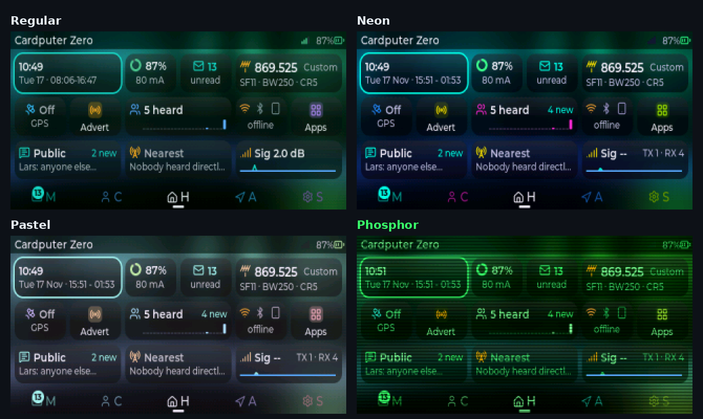

<p align="center">
  
</p>

<h1 align="center">WADAMESH for the M5Stack Cardputer Zero</h1>

<p align="center">
  <b>The whole mesh on a pocket Linux computer.</b><br>
  MeshCore chat, channels, contacts, map, GPS and a city locator on the Cardputer Zero's own<br>
  1.9" screen and 46-key keyboard. Plug in HDMI and it becomes a desktop app.
</p>

<p align="center">
  
  
  
  
  
</p>

---

The M5Stack Cardputer Zero is a Raspberry Pi CM0 in a Cardputer body: a quad-core Linux
computer with a keyboard, a battery, Wi-Fi, Bluetooth, Ethernet, HDMI and a hardware bus on
top for **Caps**. Put the **Cap LoRa-1262** (SX1262 + GPS) on it and it's a MeshCore node.
This port makes it a WADAMESH node: the same UI that runs on the T-Deck, the T-Lora Pager
and the Tanmatsu, built from the same source, running as a native Linux program.

It is a new kind of WADAMESH board. Every other board is an ESP32 or ESP32-P4 running the
firmware; here WADAMESH is the **screen, keyboard and brain**, and the radio is a MeshCore
companion running on the same Pi. Because it's Linux underneath, you also get a shell, SSH,
scripting, bots and loggers that a microcontroller can't offer.

> Ported to the Cardputer Zero from California, with a nod to the Sacramento Valley
> MeshCore crew. The valley is listening.

## Status

**Experimental, community port.** Tested on a Cardputer Zero with the Cap LoRa-1262 and
MeshCoreRPI: the LCD and keyboard (all keys and the 2D arrows), sending and receiving on a
live mesh, the battery gauge, the GPS fix, the city locator with the full California file,
the boot log, HUD, themes, the key help and sound through PipeWire. **Waiting for
confirmation on hardware:** the HDMI desktop mode, the shell on the LCD and the launcher icon. If you
try one of them, please report how it went.

## Contents

- [Status](#status)
- [What it looks like](#what-it-looks-like)
- [Features](#features)
- [What you need](#what-you-need)
- [Install](#install)
- [Using it: keys](#using-it-keys)
- [The system HUD](#the-system-hud)
- [A shell on the LCD](#a-shell-on-the-lcd)
- [HDMI desktop mode](#hdmi-desktop-mode)
- [wadamesh-cli: the mesh from SSH](#wadamesh-cli-the-mesh-from-ssh)
- [Bots: the on-message hook](#bots-the-on-message-hook)
- [GPS, the city locator and the loggers](#gps-the-city-locator-and-the-loggers)
- [Themes](#themes)
- [Sound, battery and the rest of the hardware](#sound-battery-and-the-rest-of-the-hardware)
- [Boot mode or launcher mode](#boot-mode-or-launcher-mode)
- [Files and settings](#files-and-settings)
- [Troubleshooting](#troubleshooting)
- [How it works](#how-it-works)
- [Building from source](#building-from-source)
- [What's not here yet](#whats-not-here-yet)
- [Credits](#credits)

---

## What it looks like

| | |
|:---:|:---:|
| <br>**Boot log**: real probes, then the UI | <br>**Home**: clock, battery, unread, radio, GPS, signal |
| <br>**Chats** (Phosphor theme) | <br>**A conversation**: hops, delivery, repeats heard |
| <br>**System HUD** (key `1`) | <br>**Key help** (`fn` + `H`) |
| <br>**GPS** from the Cap, and City on Home | <br>**City locator**: the city you're in, on Home |

All screenshots are the real 320x170 LCD output, shown at 2x.

## Features

**On the device**

- The full WADAMESH UI: chats and channels with delivery receipts and hop counts, contacts
  and repeaters, the map, the Store with Lua apps, settings, 15 languages.
- The Cardputer Zero's own keyboard, mapped the way M5Stack's
  [key guide](https://cardputer.cc/#/documents/cp0-keys) asks: `F` `X` `Z` `C` are the arrows
  outside a text field, and the **4 5 6 7 8** keys under the screen pick the tabs above them.
- 2D navigation: the arrows move to whatever is really above, below, left or right, like
  the T-Deck's trackball (the Pager's knob only goes forwards and backwards).
- A terminal **boot log** with real probe results: LCD, keyboard, battery, network, city
  file, GPS, the mesh link, your radio settings.
- A **system HUD**: IP, SSID, mesh link, radio, battery, GPS fix and satellites, CPU temperature,
  load, uptime, memory, disk, logger state. Refreshes every second.
- A **Linux shell** on the LCD, one key away. The mesh keeps running behind it.
- **Four looks**: Regular, Neon, Pastel and **Phosphor**, a green-on-black terminal theme with
  CRT scanlines. Phosphor is only on the Cardputer Zero.
- **Screenshots** (`fn` + `J`) as PNGs, ready for a bug report or a post.
- **Sound**: message, channel and advert tones on the speaker.
- **Real battery** from the BQ27220 fuel gauge: percentage, current, charging.
- **GPS** from the Cap LoRa-1262: position, speed, satellites, feeding the map and the
  city locator.
- **City locator**: "Now in Sacramento" and the city name on Home, offline, from US Census
  boundaries.
- **GPX track logging** and **Wi-Fi logging** in WiGLE's CSV format, both off until you turn
  them on.
- The device calls itself **M5Stack Cardputer Zero** everywhere (Settings > Device, reports).
  There may also be something hidden in it.

**Off the device**

- **HDMI desktop mode**: plug in a monitor or TV, use a mouse and any USB or Bluetooth
  keyboard, and WADAMESH runs full screen in its large-screen layout.
- **wadamesh-cli** over SSH: status, contacts, channels, send to a channel or a person,
  advert, screenshot, and `tail` to watch the mesh live.
- **Bots**: a script runs for every incoming message, and what it prints as `reply ...` goes
  back to the same chat. Rate limited so a bot can't flood the mesh.
- An icon in **M5Stack's launcher**, if you'd rather start it from there.

## What you need

| | |
|---|---|
| **M5Stack Cardputer Zero** | Raspberry Pi OS (Debian 13 "trixie") as shipped, 64-bit |
| **Cap LoRa-1262** | SX1262 radio + GPS on the top EXT bus |
| **MeshCoreRPI** | [engperini/MeshCoreRPI](https://github.com/engperini/MeshCoreRPI), the MeshCore companion that drives the Cap's radio, set up with its TCP server on port 5000 |
| A computer | To copy files over (`scp`) or to build from source |

WADAMESH talks to the radio through MeshCoreRPI's companion protocol, exactly like the
MeshCore phone app does. Get MeshCoreRPI working first (the phone app connecting to
`<zero-ip>:5000` is a good test).

> **Cap power and pins, the short version.** The Cap's SX1262 uses SPI0 CE1 for chip select,
> RESET on GPIO26, BUSY on GPIO22, IRQ on GPIO23 and DIO2 for the RF switch, with no
> TXEN/RXEN. The Cap is powered by a PI4IOE5V6408 at I²C1 0x43 (P0 high) and needs the 5 V
> EXT rail on (`/sys/class/leds/ext_5v_out/brightness`). Many units ship with a 3.0 V TCXO.
> If the preinstalled `meshzero.service` (its own meshtasticd) is running, disable it: it
> grabs GPIO 22/23/26 and the radio then receives but never transmits.

## Install

From a release, or from your own build (`web/zero/build.sh`, see
[Building from source](#building-from-source)), you get **`wadamesh-zero.tar.gz`**.

On your computer:

```sh
scp wadamesh-zero.tar.gz pi@<zero-ip>:~
```

On the Cardputer Zero (over SSH):

```sh
tar xzf wadamesh-zero.tar.gz
cd wadamesh-zero
./install.sh                      # boot mode: WADAMESH owns the LCD from power-on
# or: ./install.sh --launcher     # an app in M5Stack's launcher instead
sudo systemctl restart wadamesh-zero
```

The installer puts the programs in `/usr/local/bin`, the service in systemd, the desktop
menu entry and autostart for HDMI, the launcher icon, and an example bot in
`/var/lib/wadamesh-zero/hooks`. It also adds `/etc/sudoers.d/wadamesh`, which lets your
user run exactly `systemctl stop wadamesh-zero` and `systemctl start wadamesh-zero`
without a password: HDMI desktop mode and the launcher icon use them to hand the radio
link over, and nothing else is allowed. If the desktop's SDL2 library is missing it installs it.

Updating is the same steps with the new tarball. Your chats, settings and logs live in
`/var/lib/wadamesh-zero` and are kept.

## Using it: keys

<p align="center"></p>

Press **`fn` + `H`** on the device for this card. Any key closes it.

| Keys | What they do |
|---|---|
| `F` `X` | up / down |
| `Z` `C` | left / right |
| `OK` (Enter) | select; in a message field, send |
| `ESC` | back. **Hold** it to go Home |
| `4` `5` `6` `7` `8` | the tabs under the screen: Messages, Contacts, Home, Map, Settings |
| `1` | system HUD |
| `2` | Linux shell |
| `fn` + `F` `X` `Z` `C` | the arrows while typing (left/right move the cursor) |
| `fn` + `L` / `M` | page up / page down |
| `fn` + `K` | Home |
| `fn` + `U` / `I` | screen brightness down / up |
| `fn` + `J` | screenshot (PNG in `/var/lib/wadamesh-zero`) |
| `fn` + `H` | key help |
| `Ctrl` + `Q` | quit (the M5 launcher comes back) |

In a text field, on the PIN screen and in Lua apps that read the keyboard, every key types
what's printed on it: `F` is an F, `1` is a 1. Outside them, the shortcuts above apply.
`sym` gives the blue symbols and `shift` capitals; a single tap on a modifier holds it for
one key, a double tap locks it, as on the stock firmware.

## The system HUD

<p align="center"></p>

Press **`1`**. The HUD covers the UI with everything you'd otherwise SSH in to check:

| Row | Shows |
|---|---|
| `net` | interface, IP address and Wi-Fi network |
| `mesh` | the companion link and your node |
| `radio` | frequency, spreading factor, bandwidth, TX power |
| `batt` | charge, voltage, current, charging |
| `gps` | position and satellites, or "searching sky" |
| `cpu` | temperature, load, uptime |
| `mem` | memory in use and free disk |
| `logs` | the GPX and Wi-Fi loggers, recording or off |

Inside the HUD: **`G`** starts or stops the GPX track log, **`W`** the Wi-Fi log, **`S`**
opens the shell. Any other key closes it.

## A shell on the LCD

Press **`2`**. WADAMESH hands the screen and keyboard to a login shell on a free virtual
terminal. The mesh keeps running: messages still arrive, bots still answer. Type `exit`
to come back, or hold `ESC` for two seconds.

The shell runs as `pi`, without the extra permissions the WADAMESH service has. It needs
the kernel's text console on the LCD; if that's switched off, the HUD tells you so instead
of leaving you at a blank screen. At 320x170 the console is about 40 columns by 10 rows:
fine for `htop`, `ping`, `nmcli` and `journalctl -f`, less so for a text editor.

## HDMI desktop mode

<p align="center"></p>

Plug a monitor or TV into the HDMI port and log in to the desktop. WADAMESH opens full
screen in the **large-screen layout** (the one the Tanmatsu and the 5" CrowPanel use), with:

- the mouse as the touch screen,
- any USB keyboard, or a Bluetooth keyboard and mouse through a dongle on the USB-A port,
- the same radio, chats and settings as the LCD version (same data folder).

It starts by itself at login when HDMI is connected, and it's in the desktop menu as
**WADAMESH**. While it runs, the LCD version steps aside; close it and the LCD version comes
back. `WADA_FULLSCREEN=0 wadamesh-hdmi` runs it in a window.

## wadamesh-cli: the mesh from SSH

```sh
$ wadamesh-cli status
node     BLUFFS CARDPUTER ZERO PI
link     up: BLUFFS CARDPUTER ZERO PI via Wi-Fi
radio    909.875 MHz  BW 62.5  SF9  CR5  22 dBm
contacts 29
battery  100%  4.18 V  +120 mA  charging
gps      38.58160, -121.4944  11 sats
net      wlan0 10.0.0.69 home-wifi
system   CardputerZero  up 3h02m11s  load 0.31  48 C  mem 214/352 MB

$ wadamesh-cli send "#public" "hello from the Cardputer Zero"
sent

$ wadamesh-cli send @alice "on my way"
sent to Alice

$ wadamesh-cli tail
# tailing incoming messages (Ctrl+C to stop)
ch  Public  Lars: anyone hearing the ridge repeater today?
dm  Alice: see you at 8
```

| Command | |
|---|---|
| `status` | node, link, radio, battery, GPS, network, system |
| `contacts` | every contact with its type (chat, repeater, room, sensor) |
| `channels` | channel slots and names |
| `send #channel text` | post to a channel (`#public` matches `Public`) |
| `send @name text` | a direct message (a unique name prefix is enough) |
| `advert` | send a flood advert |
| `tail` | stream incoming DMs, channel and room posts |
| `shot` | take a screenshot, prints its path |
| `hud` | open the HUD on the device |

Messages you send from the CLI show up in the chat on the device, exactly as if you'd typed
them there. `echo status | wadamesh-cli -` reads commands from stdin. The socket is
`/var/lib/wadamesh-zero/wadamesh.sock`, a plain line protocol, so any language can use it:
`socat - UNIX-CONNECT:/var/lib/wadamesh-zero/wadamesh.sock` works too.

## Bots: the on-message hook

If `/var/lib/wadamesh-zero/hooks/on-message` exists and is executable, WADAMESH runs it for
every incoming direct message, channel post and room post, with:

| Variable | |
|---|---|
| `WADA_KIND` | `dm`, `channel` or `room` |
| `WADA_FROM` | who sent it |
| `WADA_CHANNEL` | the channel or room name |
| `WADA_TEXT` | the message |
| `WADA_HOPS`, `WADA_SNR`, `WADA_RSSI` | how it got here |
| `WADA_NODE` | your node's name |
| `WADA_DATA_DIR` | `/var/lib/wadamesh-zero` |

Every line it prints as **`reply <text>`** is sent back to the same chat. The example that
comes with it:

```sh
cp /var/lib/wadamesh-zero/hooks/on-message.example /var/lib/wadamesh-zero/hooks/on-message
```

logs every message to `messages.log` and answers direct messages:

| You send | It answers |
|---|---|
| `!ping` | `pong (2 hops, snr 7.25)` |
| `!uptime` | `up 3 hours, 2 minutes` |
| `!batt` | `battery 87%` |
| `!temp` | `cpu 48C` |
| `!help` | the list |

It's a shell script; a Python or Node bot works the same way. **Be a good neighbour on the
mesh**: replies are capped at 140 characters, one per chat every 10 seconds and six a minute,
and rooms never get automatic replies. A hook gets 10 seconds to finish. Hooks run as `pi`
without the service's extra permissions.

## GPS, the city locator and the loggers

<p align="center">
  
  
</p>

**GPS.** WADAMESH reads the Cap LoRa-1262's GPS straight from the EXT UART
(`/dev/serial0`), working out the speed (115200, 9600 or 38400) by itself. Turn it on in
**Settings > GPS**. The first fix outdoors takes a few minutes from cold; after that it's
quick. If another program already reads that port (gpsd, a MeshCore build using the GPS),
WADAMESH leaves it alone and says so in the log.

**City locator.** "Now in Sacramento", and the city's name in Home's corner instead of your
node name, from US Census place boundaries, entirely offline. Nothing is sent. To set it up:

1. Download your state's file from the
   [city files release](https://github.com/Languskhan/wadamesh/releases/tag/city-locator-v1)
   (`cities-california.bin`, `cities-texas.bin`, ...) or build one with
   `make_cities.py` (in the tarball; see [CITY_LOCATOR.md](CITY_LOCATOR.md)).
2. Put it on the Zero as `/var/lib/wadamesh-zero/cities.bin`:
   ```sh
   wget -O /tmp/cities.bin https://github.com/Languskhan/wadamesh/releases/download/city-locator-v1/cities-california.bin
   sudo install -o pi -g pi -m 644 /tmp/cities.bin /var/lib/wadamesh-zero/cities.bin
   ```
3. Turn on **GPS** and **City on Home** in Settings > GPS.

On the ESP32 boards the file lives on the SD card; the Cardputer Zero has room for a whole
state (2 MB) in memory and reads it from the data folder.

**GPX track.** In the HUD, `G`. A point every 10 metres moved, with time and altitude, into
`/var/lib/wadamesh-zero/logs/track-<date>.gpx`. Open it in any map app.

**Wi-Fi log.** In the HUD, `W`. Every 30 seconds with a fix, NetworkManager's scan list is
written with your position to `logs/wifi-<date>.wiglecsv`, in WiGLE's format and ready to
upload to [wigle.net](https://wigle.net). It's a normal scan: no monitor mode, nothing is
sent. Mind your local laws and the people around you.

## Themes

<p align="center"></p>

**Settings > Theme**, turn on **MORE COLORS!**, then pick a style:

| Style | |
|---|---|
| **Regular** | WADAMESH's own colours, a colour per section |
| **Neon** | the accent at full brightness, magenta beside it |
| **Pastel** | soft and light |
| **Phosphor** | *Cardputer Zero only.* A green CRT terminal: green text on black, amber for the radio, and real scanlines drawn over the LCD |

A new look asks to **respawn**: WADAMESH restarts in place (a second or two) to load it. For
the full terminal feel, also set **Background** to none.

## Sound, battery and the rest of the hardware

| Part | Used for |
|---|---|
| ST7789V3 1.9" LCD (`/dev/fb0`) | the UI, scaled from WADAMESH's 480x222 Pager layout with an area-averaging filter so text stays crisp; backlight on `fn`+`U`/`I` |
| TCA8418 keyboard | every key, read from evdev; M5Stack's `fn` and `sym` layers come from the kernel driver |
| ES8389 codec + AW8737A amp + speaker | notification tones. With the desktop's PipeWire running (it holds the card) they go through PipeWire to the ES8389 output by name, so HDMI being the default sink doesn't matter |
| BQ27220 fuel gauge | the battery percentage, voltage, current and charging state |
| Cap LoRa-1262: SX1262 | the mesh, through MeshCoreRPI |
| Cap LoRa-1262: GPS | position, map, city locator, GPX and Wi-Fi logs |
| Wi-Fi / Ethernet | SSH, the Store, map tiles; WADAMESH's own Wi-Fi and Bluetooth pages explain that Linux owns them |
| HDMI + USB-A | desktop mode with a mouse and keyboard |

The WADAMESH settings that belong to the Pager's hardware (its charger, its motion sensor)
are hidden on this build.

## Boot mode or launcher mode

**Boot mode** (`./install.sh`, the default): the `wadamesh-zero` service starts at power-on
and owns the LCD. M5Stack's launcher (APPLaunch) is paused while WADAMESH runs and resumed
when it stops. `Ctrl`+`Q` quits WADAMESH and gives you the launcher back; in the launcher,
the **WADAMESH** icon starts it again.

**Launcher mode** (`./install.sh --launcher`): nothing starts at boot. You get M5Stack's
launcher as usual, with a **WADAMESH** icon among the other apps. Open it to run WADAMESH;
`Ctrl`+`Q`, or holding `ESC` (the launcher's own rule for every app), takes you back.

Switch any time by running the installer again with or without `--launcher`. Turn boot mode
off by hand with `sudo systemctl disable --now wadamesh-zero`.

## Files and settings

| Path | |
|---|---|
| `/usr/local/bin/wadamesh-zero` | the LCD program |
| `/usr/local/bin/wadamesh-desktop`, `wadamesh-hdmi` | HDMI desktop mode and its launcher |
| `/usr/local/bin/wadamesh-cli` | the command line client |
| `/etc/systemd/system/wadamesh-zero.service` | boot mode |
| `/var/lib/wadamesh-zero/` | settings, chat history, `cities.bin`, screenshots, `wadamesh.sock` |
| `/var/lib/wadamesh-zero/hooks/` | `on-message` and the example |
| `/var/lib/wadamesh-zero/logs/` | GPX tracks, WiGLE CSVs |

Environment variables (add them as `Environment=` lines in the service):

| Variable | |
|---|---|
| `WADA_ZERO_GPS` | `off`, or another port than `/dev/serial0` |
| `WADA_ZERO_GPS_BAUD` | a fixed baud rate instead of auto |
| `WADA_ZERO_AUDIO=off` | silence |
| `WADA_ZERO_APLAY` | another player for tones (raw S16_LE mono on stdin) |
| `WADA_ZERO_BOOTLOG=0` | skip the boot log |
| `WADA_ZERO_KEYDEBUG=1` | log every keycode (for new keyboards or keymaps) |

Command-line options of `wadamesh-zero`: `--tcp HOST:PORT` (default in the service
`127.0.0.1:5000`), `--serial /dev/ttyX` for a USB companion, `--read-only`, `--fb`,
`--kbd`, `--rotate 180`.

## Troubleshooting

| Symptom | Fix |
|---|---|
| Black screen, but the log shows the UI running | The backlight was left at 0 by another program; WADAMESH turns it on at start. Check `cat /sys/class/backlight/*/brightness` |
| Screen flickers between WADAMESH and the launcher | Something else draws on `/dev/fb0`. The service pauses `M5CardputerZero`; check `sudo fuser -v /dev/fb0` |
| Radio receives but never transmits | `meshzero.service` (stock meshtasticd) is fighting MeshCoreRPI for the GPIOs: `sudo systemctl disable --now meshzero` |
| "companion not answering" in the boot log | MeshCoreRPI isn't up yet, or not on port 5000. `systemctl status raspberrypimc-companion` |
| No sound | `journalctl -u wadamesh-zero \| grep audio` should name a PipeWire sink or the ES8389 card. Check Settings > Sound isn't muted |
| No GPS fix | Outdoors, a few minutes from cold. `journalctl -u wadamesh-zero \| grep gps` should say "NMEA at ... baud" |
| `/dev/serial0 is in use` | Another program reads the GPS. Stop it, or set `WADA_ZERO_GPS=off` |
| City name never shows | `cities.bin` in the data folder, GPS on, City on Home on, and a fix |
| A key does the wrong thing | Run with `WADA_ZERO_KEYDEBUG=1` and open an issue with the keycodes |
| HDMI or the launcher icon leaves the LCD version running | The sudo rule is missing (`/etc/sudoers.d/wadamesh`); run `./install.sh` again |
| `wadamesh-cli: can't reach ...` | WADAMESH isn't running, or set `WADA_DATA_DIR` |

Logs: `journalctl -u wadamesh-zero -f`.

## How it works

```
 ┌──────────────── M5Stack Cardputer Zero (Raspberry Pi CM0, Linux) ────────────────┐
 │                                                                                   │
 │  wadamesh-zero ─────────────── the WADAMESH UI (src/ui-touch, LVGL), Pager layout │
 │   │  fbdev ──► /dev/fb0 1.9" LCD (480x222 → 320x170, area-averaged)               │
 │   │  evdev ◄── TCA8418 keyboard                                                   │
 │   │  NMEA  ◄── /dev/serial0 (Cap GPS)        BQ27220 ◄── /sys/class/power_supply  │
 │   │  tones ──► PipeWire / ALSA ──► ES8389 ──► speaker                             │
 │   │  wadamesh.sock ◄── wadamesh-cli, hooks/on-message                             │
 │   │                                                                               │
 │   └── MeshCore companion protocol, TCP 127.0.0.1:5000                             │
 │                    │                                                              │
 │               MeshCoreRPI ──── SPI0 ────► Cap LoRa-1262 (SX1262) ~~~ the mesh     │
 │                                                                                   │
 │  HDMI: wadamesh-desktop (same UI, large layout, SDL2) instead of wadamesh-zero    │
 └───────────────────────────────────────────────────────────────────────────────────┘
```

The port is built on WADAMESH's own **web/host build** (see [WEB_BUILD.md](WEB_BUILD.md)):
the real UI compiled for a computer, driving a real MeshCore companion over its protocol.
The Cardputer Zero is a new board in that build:

- `-DWADA_ZERO=ON` lays the UI out as the T-Lora Pager (480x222, keyboard-first, the
  closest shipping form factor) and replaces the SDL window with `web/zero/zero_main.cpp`:
  framebuffer output, evdev input, the overlays (boot log, HUD, key help), the shell, and
  the board's hardware (`zero_battery.cpp`, `zero_gps.cpp`, `zero_audio.cpp`).
- `wadamesh-desktop` is the normal host build with SDL2 loaded at run time
  (`web/desktop/sdl2_dlshim.c`), so it cross-compiles without an arm64 SDL2.
- Changes to shared source are `#if defined(WADA_ZERO)` blocks: the board's name and ID,
  2D arrow navigation, the Phosphor style, the city locator reading from the data folder,
  and the Pager settings that don't apply. Every other board builds exactly as before.

## Building from source

On a 64-bit Linux PC (Debian or Ubuntu), cross-compiling for the Zero's arm64:

```sh
sudo apt install cmake ninja-build g++-aarch64-linux-gnu libsdl2-dev python3
git clone https://github.com/ALLFATHER-BV/wadamesh.git
cd wadamesh
web/zero/build.sh          # -> web/zero/out/wadamesh-zero.tar.gz
```

`build.sh` fetches the pinned third-party sources (`web/fetch-deps.sh`), copies the SDL2
headers for the desktop build (`web/desktop/vendor-sdl2-headers.sh`), builds both programs,
and packs them with the installer. The binaries need glibc 2.38 or newer and link
`libstdc++` statically. Building on the Zero itself works too, but the 80,000-line
`UITask.cpp` needs close to 500 MB of memory to compile, so add swap first.

To try it without a Zero: build natively with `-DWADA_ZERO=ON` and run with
`WADA_ZERO_FAKEFB=320x170 wadamesh-host --fb /tmp/screen.raw` (the demo mesh), which renders
into a raw RGB565 file.

`web/zero/zero_help.h` (the key help) and `web/zero/zero_font.h` (the terminal font) are
generated by `gen_help.py` and `gen_font.py` in the same folder.

## What's not here yet

- **Compass** on the map from the BMI270/BMM150: needs a calibration step first.
- **Signal, Discover, Spectrum, RF Monitor, Wardrive**: these need the radio itself, which
  MeshCoreRPI owns. A companion protocol extension could bring them over.
- **Camera, IR, the Grove port and other Caps**: available to Lua apps and Linux programs,
  not used by WADAMESH itself.
- **A `.deb` and a CardputerZero Store listing.**

Issues and pull requests welcome.

## Credits

- **[WADAMESH](https://github.com/ALLFATHER-BV/wadamesh)** by Meshcomod / ALLFATHER-BV: the
  firmware, the UI and the host build this port stands on. GPL-3.0.
- **City locator** by [Languskhan](https://github.com/Languskhan).
- **Cardputer Zero port** by [Languskhan](https://github.com/Languskhan), from California.
- **MeshCore** and **[MeshCoreRPI](https://github.com/engperini/MeshCoreRPI)**: the mesh and
  the radio underneath.
- **[M5Stack](https://docs.m5stack.com/en/CardputerZero)**: the Cardputer Zero, its key
  guide and its kernel drivers.
- And the **Sacramento Valley MeshCore** community, for the repeaters on the ridge.

---

<sub>A note for the curious. Some old codes still work: the kind you entered on a
controller in 1986 to start with thirty lives. On this keyboard the arrows wear different
letters (you'll find them in the key help) and the last two buttons are where they always
were. Try it on any screen where you're not typing. The valley is listening.</sub>
